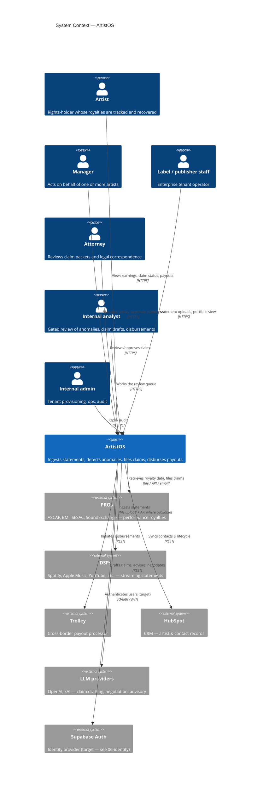

# 01 — System Context (C4 Level 1)

**Status:** Current.

ArtistOS is a royalty-recovery platform for music-industry rights-holders. It ingests earnings statements, identifies underpayments, generates evidence-backed claims, negotiates with payers, and disburses recovered funds to artists.

This doc draws the system's outer boundary — who uses it, what it talks to.

## Diagram

## Actors

| Actor | What they do | Auth |
|---|---|---|
| **Artist** | Signs up (self-serve or invited), views royalty data, approves claim filings, receives payouts. | Artist-scoped JWT (today: `artist_id` only — unsafe; target: Supabase magic-link + password). |
| **Manager / label / attorney** | Role-scoped portfolio access; depending on tier, may approve legal correspondence or disbursements. | Same as above, with additional role claims. |
| **Internal analyst** | Gated review of anomalies, claim drafts, disbursements before they go out. See [`docs/analyst_gated_recovery_advance_system.md`](../analyst_gated_recovery_advance_system.md). | Role claim `analyst`. |
| **Internal admin** | Tenant provisioning, auditing, ops. | Role claim `admin`. |

## External systems

| System | Purpose | Direction | Protocol |
|---|---|---|---|
| **PROs** (ASCAP, BMI, SESAC, SoundExchange) | Source of performance-royalty statements and recipient of claims | Bi-directional | File upload, email, a small amount of API where available |
| **DSPs** (Spotify, Apple Music, YouTube, etc.) | Source of streaming statements | Inbound | File upload (statements) + API for creator data where available |
| **Trolley** | Disburses recovered funds to artists across borders | Outbound | REST — [`XR7/trolley/client.py`](../../XR7/trolley/client.py) |
| **HubSpot** | CRM — artist contacts, onboarding lifecycle, sales | Bi-directional | REST — [`XR7/services/hubspot_client.py`](../../XR7/services/hubspot_client.py) |
| **LLM providers** (OpenAI, xAI) | Claim drafting, negotiation assistance, advisor agents | Outbound | REST via LangChain — [`XR7/llm/`](../../XR7/llm/) |
| **Supabase Auth** (target) | Identity provider | Bi-directional | OAuth / JWT — not yet integrated, see [06-identity](06-identity.md) |

Only providers with a concrete client in the repo today are listed as "Found" in [05-integrations](05-integrations.md). Statement sources without a dedicated client are served by the generic statement-upload pipeline in [04-data-flows](04-data-flows.md).

## What ArtistOS is not

- Not a DSP or a PRO — it acts as a rights-holder advocate against them.
- Not a general accounting system — it tracks only royalty-derived revenue.
- Not a music distribution platform — it starts after distribution has happened.

## See also

- [02 — Containers](02-containers.md) for what runs inside the ArtistOS boundary
- [04 — Data flows](04-data-flows.md) for the recovery lifecycle end-to-end
- [05 — Integrations](05-integrations.md) for the external-system matrix
