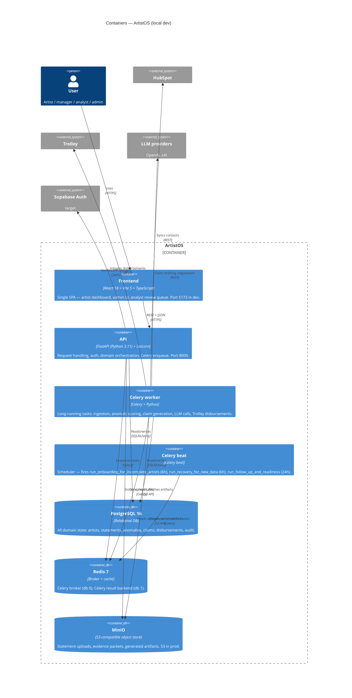

# 02 — Containers (C4 Level 2)

**Status:** Current. Reflects [`docker-compose.yml`](../../docker-compose.yml) at repo root.

Zoom in on what runs inside the ArtistOS boundary. This is the local-dev topology; AWS topology lives in [03-deployment](03-deployment.md).

## Diagram

## Containers in detail

### Frontend ([`frontend/`](../../frontend/))
- **Stack:** React 18.3, Vite 5.4, TypeScript.
- **Dev:** Vite dev server, port 5173. `VITE_API_BASE_URL=http://localhost:8000`.
- **Prod:** `npm run build` → static bundle, served by CloudFront (see [03-deployment](03-deployment.md)).
- **Single SPA** — routes gate by role claim: artist / manager / analyst / admin.

### API ([`XR7/api/app.py`](../../XR7/api/app.py))
- **Stack:** FastAPI, SQLAlchemy, Pydantic, Uvicorn.
- **Responsibilities:** request validation, auth, domain orchestration, synchronous reads, enqueuing work for the worker.
- **Notable subpackages:**
  - [`XR7/api/routers/`](../../XR7/api/routers/) — HTTP routers per domain
  - [`XR7/auth/`](../../XR7/auth/) — JWT verification (`jwt_service.py`)
  - [`XR7/models/`](../../XR7/models/) — SQLAlchemy ORM models
  - [`XR7/services/`](../../XR7/services/) — business service layer
- **Sync vs async:** API handles synchronous reads + fast writes. Anything slow (ingestion, LLM, anomaly scoring, disbursement) is handed to Celery.

### Celery worker ([`XR7/celery_app.py`](../../XR7/celery_app.py) + [`XR7/tasks/`](../../XR7/tasks/))
- **Stack:** Celery with Redis broker.
- **Task surfaces:** [`XR7/tasks/pipeline.py`](../../XR7/tasks/pipeline.py), [`XR7/tasks/celery_tasks.py`](../../XR7/tasks/celery_tasks.py), [`XR7/tasks/hubspot.py`](../../XR7/tasks/hubspot.py).
- **Calls out to:** Postgres, MinIO/S3, HubSpot, Trolley, LLM providers.
- Full task registry: [`docs/celery_workflows.md`](../celery_workflows.md).

### Celery beat (scheduler)
- Same image as the worker, `celery beat` entrypoint.
- Periodic jobs configured in [`XR7/celery_app.py`](../../XR7/celery_app.py):
  - `run_onboarding_for_incomplete_artists` — every 6 h
  - `run_recovery_for_new_data` — every 6 h
  - `run_follow_up_and_readiness` — every 24 h

### PostgreSQL 16
- Single logical database `xr7`.
- All domain state: artists, statements, anomalies, claims, disbursements, admin audit logs, ledger.
- Migrations: Alembic — [`alembic/versions/`](../../alembic/versions/).
- Connection string is injected via `DATABASE_URL` (settings module: [`xr7_common/settings.py`](../../xr7_common/settings.py)).

### Redis 7
- **db 0** — Celery broker
- **db 1** — Celery result backend
- Also used for opportunistic application cache.

### MinIO (local) / S3 (prod)
- S3-compatible object storage.
- Uploaded statements, generated evidence packets, any file artifacts.
- Bucket `xr7-artifacts` in dev. Endpoint swaps to AWS S3 in prod — see [03-deployment](03-deployment.md).

## Internal module boundaries

Within the API and worker, the codebase splits roughly along domain lines. Each lives under `XR7/`:

| Package | Responsibility |
|---|---|
| `ingestion` | Statement parsing, file pipeline, creator platform parsers |
| `anomaly` / `ml` | Rule-based + ML anomaly detection (IsolationForest, z-score, missingness) |
| `recovery` | Claim drafting, evidence packaging, statute-of-limitations tracking |
| `llm` | LLM-backed claim drafter, advisor, negotiation agent |
| `trolley` | Disbursement client |
| `billing` | Billing and payout orchestration |
| `agents` | LangGraph multi-agent orchestration |
| `services` | Cross-cutting business services (HubSpot, branding, audit) |
| `models` | SQLAlchemy ORM models |
| `observability` | Structured logging helpers (Prometheus wiring pending — see [07](07-observability.md)) |

## Build & image layout

A single `Dockerfile` at the repo root builds the Python image used by **api**, **worker**, and **scheduler** — they only differ in entrypoint command. Frontend uses a generic `node:20` image for dev; prod ships the static Vite build to CloudFront (no runtime container needed).

## See also

- [03 — Deployment](03-deployment.md) for the AWS production topology
- [04 — Data flows](04-data-flows.md) for how these containers interact across the recovery lifecycle
- [`docs/celery_workflows.md`](../celery_workflows.md) for the full Celery task registry
