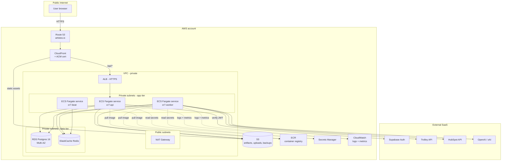

# 03 — Deployment

> **Status: TARGET.** Deployment is being built out. See [EPIC #102](https://github.com/k6-labs-hq/ArtistOS/issues/102).
>
> **Current direction (2026-04-21): Hetzner for MVP, AWS-portable.** Per [cloud provider evaluation](../decisions/cloud-provider-evaluation.md). The Hetzner deployment layer lives in [`infrastructure/hetzner/`](../../infrastructure/hetzner/). Portability to AWS preserved via [`infrastructure/PORTABILITY.md`](../../infrastructure/PORTABILITY.md). This doc retains the AWS target topology as a reference for the future migration.

## Rationale (why this stack)

- **Hetzner over AWS for MVP** — 5–7× cheaper at comparable specs, EU hosting simplifies GDPR, portable to AWS when scale or enterprise deals demand it. Trigger criteria in the [cloud provider evaluation](../decisions/cloud-provider-evaluation.md).
- **Docker Compose over Kubernetes** — single VM is enough at MVP. Translates directly to ECS Task Definitions or Cloud Run on migration.
- **Managed Postgres everywhere** — royalty data is financial; automated backups and point-in-time recovery are non-negotiable. Hetzner Managed Postgres today, RDS on migration.
- **Supabase for auth, not Cognito** — already decided in [#99](https://github.com/k6-labs-hq/ArtistOS/issues/99). Auth is a SaaS boundary and stays identical across clouds. See [06-identity](06-identity.md).

## Target topology

## Component mapping

| Local dev (Compose) | Production (AWS) | Notes |
|---|---|---|
| `api` container | ECS Fargate service `xr7-api` behind ALB | Min 2 tasks for HA, target-tracking autoscale on CPU + ALB request count |
| `worker` container | ECS Fargate service `xr7-worker` | Min 2 tasks; scale on Celery queue depth once [#95](https://github.com/k6-labs-hq/ArtistOS/issues/95) lands |
| `scheduler` container | ECS Fargate service `xr7-beat` | **Exactly 1 task** — beat cannot run in multiple instances |
| `postgres` | RDS Postgres 16 Multi-AZ | `db.t4g.medium` at MVP; automated backups, PITR, 7-day retention |
| `redis` | ElastiCache Redis (single node at MVP; cluster-mode later) | Encryption in transit + at rest |
| `minio` | S3 buckets: `xr7-uploads`, `xr7-artifacts`, `xr7-backups` | Versioning on, lifecycle to Glacier after 90 d for backups |
| `frontend` (Vite dev server) | Static bundle in S3 + CloudFront | Build in CI, invalidate on deploy |
| `.env` | AWS Secrets Manager | Secrets referenced by ARN in ECS task definitions |

## Environments

| Env | AWS account | Domain | Data |
|---|---|---|---|
| Local | — | `localhost` | MinIO + local Postgres |
| Staging | Same account, separate VPC/prefix | `staging.artistos.io` | Sanitized prod snapshot or synthetic |
| Prod | Same account (or separate — decision in #102) | `artistos.io` | Real |

Supabase projects mirror these — see [06-identity](06-identity.md).

## Networking

- **VPC** — single VPC per environment, 2 AZs minimum.
- **Subnets** — public (ALB, NAT), app-private (ECS), data-private (RDS, ElastiCache).
- **Security groups** — ALB → api; api/worker/beat → RDS, Redis; outbound 443 only from app tier.
- **No public IPs** on ECS tasks; outbound via NAT.

## Deployment flow

1. CI builds image on merge to `main` → push to ECR.
2. CI runs Alembic migrations against RDS.
3. CI updates ECS service task definition → Fargate rolling deploy.
4. Smoke test against a known synthetic artist.
5. Frontend: Vite build → `aws s3 sync` → CloudFront invalidation.

CI/CD details live in [`docs/cicd_pipeline_reference.md`](../cicd_pipeline_reference.md) (pre-dates this move to AWS; update required when #102 lands).

## Backup & DR

- **RDS:** automated daily snapshots, 7-day retention; PITR.
- **S3:** versioning + cross-region replication for `xr7-backups`.
- **Restore drill:** quarterly — see [`docs/disaster_recovery_backup_strategy.md`](../disaster_recovery_backup_strategy.md).

## Cost envelope (MVP)

Per [#102](https://github.com/k6-labs-hq/ArtistOS/issues/102): roughly **$200–$400 / month** at MVP scale. Dominated by RDS Multi-AZ and NAT egress.

## Open decisions (from #102)

- [ ] Domain name (artistos.io vs xr7.com vs subdomain)
- [ ] New AWS account vs existing
- [ ] Who owns the AWS bill

## See also

- [EPIC #102](https://github.com/k6-labs-hq/ArtistOS/issues/102) — implementation tracking
- [`docs/production_deployment_guide.md`](../production_deployment_guide.md) — operator runbook (will need revision)
- [07 — Observability](07-observability.md) — what we wire into CloudWatch + Prometheus
