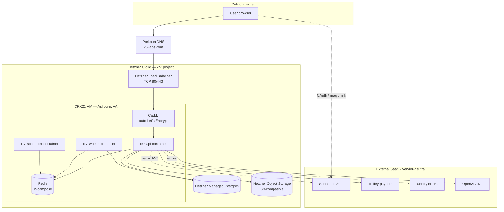
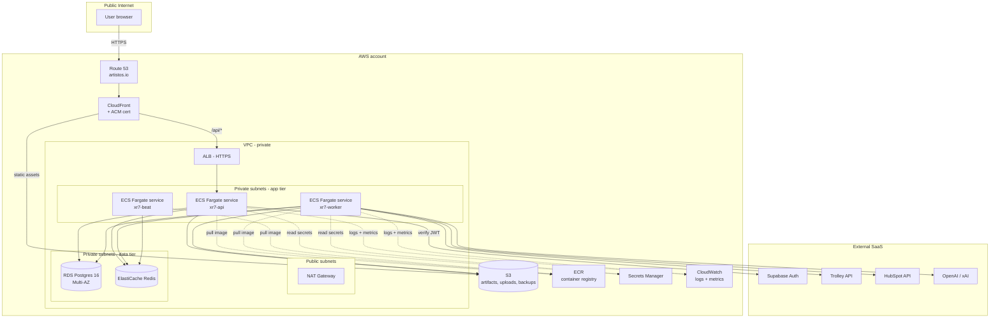

# 03 — Deployment

> **Status: TARGET.** Deployment is being built out. See [EPIC #102](https://github.com/k6-labs-hq/ArtistOS/issues/102).
>
> **Current direction (2026-04-21): Hetzner for MVP, AWS-portable.** Per [cloud provider evaluation](../decisions/cloud-provider-evaluation.md). The Hetzner deployment layer lives in [`infrastructure/hetzner/`](../../infrastructure/hetzner/). Portability to AWS preserved via [`infrastructure/PORTABILITY.md`](../../infrastructure/PORTABILITY.md). This doc retains the AWS target topology as a reference for the future migration.

## Rationale (why this stack)

- **Hetzner over AWS for MVP** — 5–7× cheaper at comparable specs, EU hosting simplifies GDPR, portable to AWS when scale or enterprise deals demand it. Trigger criteria in the [cloud provider evaluation](../decisions/cloud-provider-evaluation.md).
- **Docker Compose over Kubernetes** — single VM is enough at MVP. Translates directly to ECS Task Definitions or Cloud Run on migration.
- **Managed Postgres everywhere** — royalty data is financial; automated backups and point-in-time recovery are non-negotiable. Hetzner Managed Postgres today, RDS on migration.
- **Supabase for auth, not Cognito** — already decided in [#99](https://github.com/k6-labs-hq/ArtistOS/issues/99). Auth is a SaaS boundary and stays identical across clouds. See [06-identity](06-identity.md).

## Current topology (Hetzner, MVP)

**Per-environment hostnames** ([see access policy](../decisions/access-policy.md)):

| Env | API | Frontend |
|---|---|---|
| QA | `api.qa.xr7.k6-labs.com` | `app.qa.xr7.k6-labs.com` |
| Prod | `api.xr7.k6-labs.com` | `app.xr7.k6-labs.com` |

> `api.k6-labs.com` is reserved for a separate product (arcos7) — ArtistOS lives under `*.xr7.k6-labs.com`.

### Component mapping — Hetzner (today)

| Local dev (Podman Compose) | Hetzner (QA/Prod) |
|---|---|
| `api` container | Docker Compose service on CPX21 VM, Caddy reverse-proxy in front |
| `worker` container | Docker Compose service (Celery) |
| `scheduler` container | Docker Compose service (Celery beat, single instance) |
| `postgres` | Hetzner Managed Postgres (automated backups) |
| `redis` | Docker Compose service (data ephemeral; accepts for MVP) |
| `minio` | Hetzner Object Storage (S3-compatible, same boto3 client) |
| `frontend` Vite dev server | Static bundle served by Caddy or on Object Storage + Caddy proxy |
| `.env` | `.env.qa` / `.env.prod` on VM (0600 perms); migrate to Doppler pre-launch |

### Deployment flow — Hetzner

1. CI builds image on merge to `main` → push to GHCR (`ghcr.io/k6-labs-hq/artistos:<sha>`)
2. Auto-deploy QA: GitHub Actions SSHes to QA VM, runs `infrastructure/hetzner/deploy.sh` which pulls the new image, runs `alembic upgrade head`, rolling `docker compose up -d`
3. Smoke test against `https://api.qa.xr7.k6-labs.com/health`
4. Prod deploy: `workflow_dispatch` with admin approval on the `prod` GitHub Environment → same SSH flow against prod VM
5. Rollback: re-run workflow against previous image SHA

CI definition: [`.github/workflows/deploy-hetzner.yml`](../../.github/workflows/deploy-hetzner.yml).

### Cost envelope — Hetzner (MVP)

Roughly **€25–35 / month** at MVP scale (€6 VM + €15 managed Postgres + €5 object storage + €1 snapshots + free bandwidth up to 20 TB). Per-environment cost doubles for QA + Prod.

---

## AWS migration target topology

### Component mapping — AWS (future target)

| Local dev (Compose) | Production (AWS) | Notes |
|---|---|---|
| `api` container | ECS Fargate service `xr7-api` behind ALB | Min 2 tasks for HA, target-tracking autoscale on CPU + ALB request count |
| `worker` container | ECS Fargate service `xr7-worker` | Min 2 tasks; scale on Celery queue depth once [#95](https://github.com/k6-labs-hq/ArtistOS/issues/95) lands |
| `scheduler` container | ECS Fargate service `xr7-beat` | **Exactly 1 task** — beat cannot run in multiple instances |
| `postgres` | RDS Postgres 16 Multi-AZ | `db.t4g.medium` at MVP; automated backups, PITR, 7-day retention |
| `redis` | ElastiCache Redis (single node at MVP; cluster-mode later) | Encryption in transit + at rest |
| `minio` | S3 buckets: `xr7-uploads`, `xr7-artifacts`, `xr7-backups` | Versioning on, lifecycle to Glacier after 90 d for backups |
| `frontend` (Vite dev server) | Static bundle in S3 + CloudFront | Build in CI, invalidate on deploy |
| `.env` | AWS Secrets Manager | Secrets referenced by ARN in ECS task definitions |

### Environments — AWS (future target)

| Env | AWS account | Domain | Data |
|---|---|---|---|
| Local | — | `localhost` | MinIO + local Postgres |
| QA | Same account, separate VPC/prefix | `api.qa.xr7.k6-labs.com` | Seed/synthetic only |
| Prod | Same account (or separate) | `api.xr7.k6-labs.com` | Real |

Supabase projects mirror these — see [06-identity](06-identity.md).

### Networking — AWS (future target)

- **VPC** — single VPC per environment, 2 AZs minimum.
- **Subnets** — public (ALB, NAT), app-private (ECS), data-private (RDS, ElastiCache).
- **Security groups** — ALB → api; api/worker/beat → RDS, Redis; outbound 443 only from app tier.
- **No public IPs** on ECS tasks; outbound via NAT.

### Deployment flow — AWS (future target)

1. CI builds image on merge to `main` → push to ECR.
2. CI runs Alembic migrations against RDS.
3. CI updates ECS service task definition → Fargate rolling deploy.
4. Smoke test against a known synthetic artist.
5. Frontend: Vite build → `aws s3 sync` → CloudFront invalidation.

### Cost envelope — AWS (future, at MVP scale)

Roughly **$200–$400 / month**. Dominated by RDS Multi-AZ and NAT egress.

## Open decisions

- [ ] Domain confirmed: `*.xr7.k6-labs.com` (2026-04-22)
- [x] Cloud provider chosen: Hetzner for MVP (2026-04-21)
- [ ] Production Hetzner VM provisioned
- [ ] Production secrets stored in Doppler / Vault (MVP: 0600 file on VM)

## See also

- [EPIC #102](https://github.com/k6-labs-hq/ArtistOS/issues/102) — implementation tracking
- [`docs/production_deployment_guide.md`](../production_deployment_guide.md) — operator runbook (will need revision)
- [07 — Observability](07-observability.md) — what we wire into CloudWatch + Prometheus
