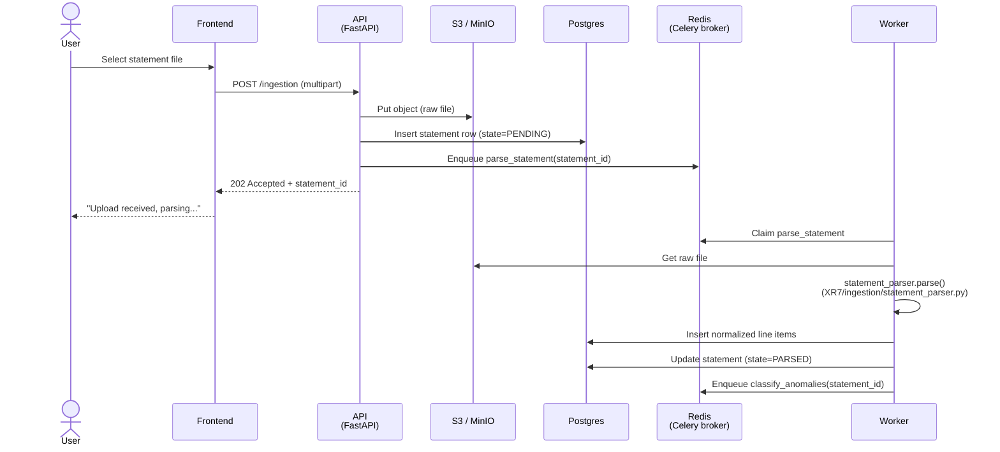
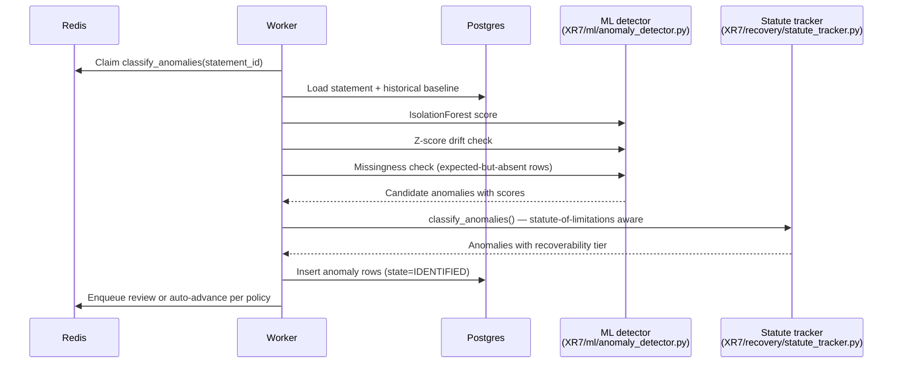
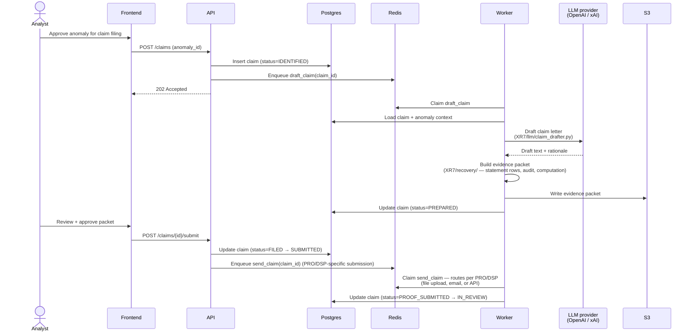
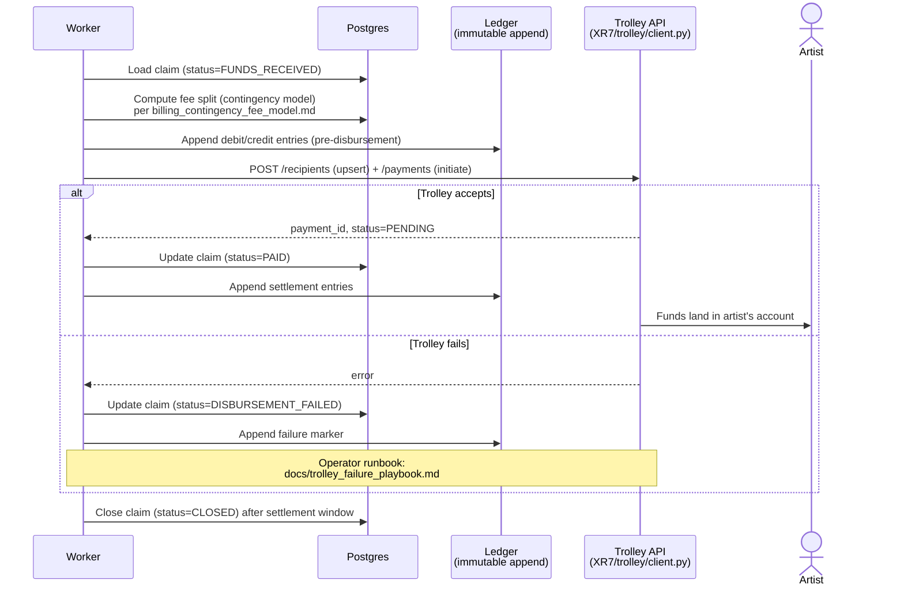

# 04 — Data Flows

**Status:** Current. Sequence diagrams for the four flows that together make up the recovery lifecycle.

## 1. Statement ingestion

**Trigger:** a user (artist / manager / label staff) uploads a royalty statement file.

**Code anchors:**
- Router: [`XR7/api/routers/ingestion.py`](../../XR7/api/routers/ingestion.py)
- Parser: [`XR7/ingestion/statement_parser.py`](../../XR7/ingestion/statement_parser.py)
- Pipeline: [`XR7/ingestion/file_ingestion_pipeline.py`](../../XR7/ingestion/file_ingestion_pipeline.py)

**Ingestion format catalog:** [`docs/ingestion_format_catalog.md`](../ingestion_format_catalog.md).

## 2. Anomaly detection

**Trigger:** a parsed statement enters `classify_anomalies`, OR scheduled recovery scan (`run_recovery_for_new_data`, every 6 h).

**Code anchors:**
- Rule + ML engine: [`XR7/ml/anomaly_detector.py`](../../XR7/ml/anomaly_detector.py)
- Statute-aware classifier: [`XR7/recovery/statute_tracker.py`](../../XR7/recovery/statute_tracker.py)
- Router: [`XR7/api/routers/anomalies.py`](../../XR7/api/routers/anomalies.py)

**Rule catalog:** [`docs/anomaly_rule_catalog.md`](../anomaly_rule_catalog.md).

## 3. Claim filing

**Trigger:** an anomaly passes analyst review (or policy auto-advance), becoming a claim draft.

**Claim state machine:** `IDENTIFIED → PREPARED → FILED → SUBMITTED → PROOF_SUBMITTED → IN_REVIEW → ACCEPTED → FUNDS_RECEIVED → PAID → CLOSED`, with a `DISBURSEMENT_FAILED` branch. Defined in [`XR7/models/claim.py`](../../XR7/models/claim.py).

**Code anchors:**
- State machine: [`XR7/models/claim.py`](../../XR7/models/claim.py)
- Router: [`XR7/api/routers/claims.py`](../../XR7/api/routers/claims.py)
- LLM drafter: [`XR7/llm/claim_drafter.py`](../../XR7/llm/claim_drafter.py)
- Audit: [`XR7/services/claim_status_audit.py`](../../XR7/services/claim_status_audit.py)

Detailed runbook: [`docs/claims_state_machine.md`](../claims_state_machine.md).

## 4. Payout (Trolley disbursement)

**Trigger:** claim reaches `FUNDS_RECEIVED` — payer has settled and money is with us to distribute.

**Code anchors:**
- Trolley client: [`XR7/trolley/client.py`](../../XR7/trolley/client.py)
- Router: [`XR7/api/routers/trolley.py`](../../XR7/api/routers/trolley.py)
- Billing / payout orchestration: [`XR7/billing/`](../../XR7/billing/)

**Fee model:** [`docs/billing_contingency_fee_model.md`](../billing_contingency_fee_model.md).
**Failure playbook:** [`docs/trolley_failure_playbook.md`](../trolley_failure_playbook.md).

## Cross-cutting: human-in-the-loop gates

Two points in the lifecycle are gated by an analyst (configurable per tenant / policy):

1. **Anomaly → claim draft** — analyst approves before LLM spends tokens drafting.
2. **Claim packet → submission** — analyst approves the generated packet before it's sent to the payer.

See [`docs/analyst_gated_recovery_advance_system.md`](../analyst_gated_recovery_advance_system.md).

## Cross-cutting: ledger

Every decision that moves money or obligation is append-only to the immutable ledger (`XR7/blockchain/` + `XR7/transparency/`). Used for audit, reconciliation, and investor-grade provenance. See [`docs/data_lineage_provenance_tracking.md`](../data_lineage_provenance_tracking.md).

## See also

- [02 — Containers](02-containers.md) for which container owns each step
- [05 — Integrations](05-integrations.md) for the external-system boundary details
- [`docs/celery_workflows.md`](../celery_workflows.md) for the full task registry + beat schedule
