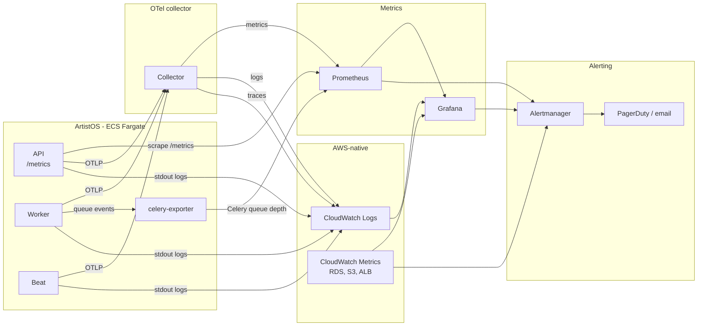

# 07 — Observability

> **Status: TARGET.** Minimal observability today: structured logs only. Metrics, tracing, and alerting are pending a run of five open issues ([#94](https://github.com/k6-labs-hq/ArtistOS/issues/94)–[#98](https://github.com/k6-labs-hq/ArtistOS/issues/98)). Update this doc as each lands.

## Current state

| Signal | Status |
|---|---|
| Structured logs | ✅ In place — [`xr7_common/logging.py`](../../xr7_common/logging.py), configured in [`XR7/api/app.py`](../../XR7/api/app.py) via `configure_structured_logging()` |
| Prometheus `/metrics` | ❌ Not exposed (application-level queue metrics exist only inside [`XR7/api/routers/review_queue.py`](../../XR7/api/routers/review_queue.py)) |
| Celery metrics | ❌ No celery-exporter |
| Traces | ❌ No OpenTelemetry |
| CloudWatch integration | ❌ No AWS deployment yet (see [03](03-deployment.md)) |
| Alerting | ❌ No Grafana / PagerDuty wiring |

The existing [`docs/observability_monitoring_stack.md`](../observability_monitoring_stack.md) is a stub runbook; this doc is the target architecture it should converge on.

## Target topology

## Components

### 1. `/metrics` on the API ([#94](https://github.com/k6-labs-hq/ArtistOS/issues/94))
- `prometheus-fastapi-instrumentator` or similar; expose at `/metrics`.
- Default HTTP request/latency histograms.
- App-level counters for: claims filed, anomalies detected, disbursements, LLM token spend.

### 2. Celery metrics via celery-exporter ([#95](https://github.com/k6-labs-hq/ArtistOS/issues/95))
- Sidecar `danihodovic/celery-exporter` (or equivalent).
- Queue depth, task throughput, failure rate, latency by task name.
- Drives **autoscaling** for worker ECS service in prod.

### 3. Prometheus + Grafana ([#96](https://github.com/k6-labs-hq/ArtistOS/issues/96))
- Prometheus: ECS service with persistent EBS, scrape targets from ECS service discovery.
- Grafana: ECS service, backed by RDS Postgres or its own instance.
- Baseline dashboards: API RED, Celery queues, RDS, business KPIs (claims/day, recovery $).

### 4. CloudWatch integration ([#97](https://github.com/k6-labs-hq/ArtistOS/issues/97))
- RDS metrics (CPU, IOPS, replica lag), S3 metrics, ALB request metrics — pulled from CloudWatch into Grafana via the CloudWatch datasource.
- Avoids running our own exporters for managed services.

### 5. OpenTelemetry ([#98](https://github.com/k6-labs-hq/ArtistOS/issues/98))
- OTel SDK in API + worker. Exporter → OTel Collector (sidecar or cluster-level).
- Traces: HTTP → Celery task → DB, Trolley, HubSpot, LLM calls.
- Collector fans out traces to CloudWatch Logs (cheap) and optionally a trace backend later.

## Log strategy

- Structured JSON to stdout (already in place).
- CloudWatch Logs captures container stdout (ECS awslogs driver).
- Log fields include `tenant_id`, `request_id`, `trace_id` (once OTel lands), `actor_user_id`.
- Log retention: 30 d hot, archived to S3 `xr7-backups` after.

## Alerting

Target SLOs (reviewed quarterly):

| SLO | Target | Primary signal |
|---|---|---|
| API availability | 99.5% / 30 d | ALB 5xx rate |
| Claim-draft latency | p95 < 60 s | Celery task duration |
| Disbursement success rate | 99% / 7 d | Trolley client outcomes |
| Statement parse success | 98% / 7 d | Ingestion task outcomes |

Alerts page on burn-rate breach; warning to chat first, paging after sustained breach.

## What lives where

| Concern | Owner | Doc |
|---|---|---|
| Instrumenting new code | Feature author | [08 — Security](08-security-boundaries.md) for what **not** to log |
| Dashboard changes | On-call | (new — `docs/observability_monitoring_handbook.md` will be updated post-[#96](https://github.com/k6-labs-hq/ArtistOS/issues/96)) |
| Incident response | On-call | [`docs/incident_response_runbook_index.md`](../incident_response_runbook_index.md) |
| SLO review | Eng leads | Quarterly cadence, tracked in engineering ops |

## What we are *not* doing (yet)

- No APM (Datadog / New Relic) — Prometheus + CloudWatch is enough at MVP.
- No synthetic monitoring until we have a production environment with a real domain.
- No per-tenant cost attribution dashboards — nice-to-have post-GA.

## See also

- [#94](https://github.com/k6-labs-hq/ArtistOS/issues/94)–[#98](https://github.com/k6-labs-hq/ArtistOS/issues/98) — implementation issues
- [`docs/observability_monitoring_stack.md`](../observability_monitoring_stack.md) — current runbook
- [`docs/incident_response_runbook_index.md`](../incident_response_runbook_index.md) — on-call procedures
- [03 — Deployment](03-deployment.md) — where these services run in AWS
