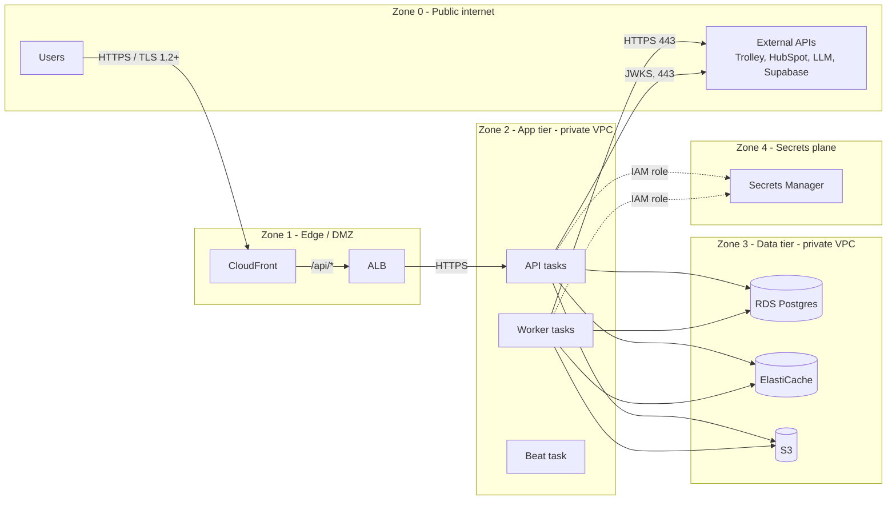

# 08 — Security Boundaries

**Status:** Current (trust zones as designed; AWS topology pending [03-deployment](03-deployment.md)).

This doc defines trust zones, data classification, and the rules that govern what crosses each boundary. Detailed controls and the STRIDE threat model live in [`docs/security_hardening_plan.md`](../security_hardening_plan.md) and [`docs/security_threat_model.md`](../security_threat_model.md); this doc is the boundary map.

## Trust zones

## Zone rules

| Zone | Contains | Accepts inbound from | Allowed outbound |
|---|---|---|---|
| **Z0 — Public** | End users, external SaaS | n/a | n/a |
| **Z1 — Edge** | CloudFront, ALB | Z0 (443 only), ACM-terminated TLS | Z2 (api only) |
| **Z2 — App tier** | ECS tasks (api, worker, beat) | Z1 (ALB → api), internal service discovery | Z3 (data tier), Z0 (443 only, via NAT for worker/api egress) |
| **Z3 — Data tier** | RDS, ElastiCache, S3 | Z2 only (security groups + bucket policies) | None (no internet egress) |
| **Z4 — Secrets** | Secrets Manager | IAM-scoped reads from Z2 | None |

**Key rules:**
- No component in Z3 has a public IP or route to the internet.
- Worker/API egress to external APIs (Z0) is through a single NAT gateway per AZ — enables IP allowlisting at external partners when needed (Trolley).
- Secrets never land on disk except as environment variables injected at task start.

## Data classification

| Tier | Examples | Storage | At rest | In transit | Logged? |
|---|---|---|---|---|---|
| **Tier 0 — Public** | Marketing content, docs | S3 `xr7-public` | Default AES-256 | HTTPS | OK to log |
| **Tier 1 — Internal** | Feature flags, app config (non-secret) | App DB, env vars | Default AES-256 | HTTPS / in-VPC | OK to log |
| **Tier 2 — PII** | Name, email, contact info, artist identifiers | RDS | AES-256 (RDS default) + column-level encryption for sensitive fields | HTTPS / TLS | **Never log** — use `actor_user_id` and `tenant_id` tokens |
| **Tier 3 — Financial** | Statement line items, claim amounts, disbursement records, bank account details (via Trolley) | RDS + `XR7/services/xr7_crypto_vault.py` for secrets | AES-256 + vault-level encryption for bank-account tokens | HTTPS only; no email | **Never log** raw amounts tied to PII |
| **Tier 4 — Auth secrets** | JWT signing keys, API keys, DB passwords | Secrets Manager | KMS-encrypted | IAM-scoped fetch over HTTPS | **Never log** |

**Rule of thumb:** if a log line would be useful to a fraudster or a curious employee, it's too much. The structured logger should be passing IDs, not values.

## Secrets management

| Env | Where secrets live |
|---|---|
| Local dev | `.env` file at repo root, gitignored. See [`.env.example`](../../.env.example) |
| Staging / prod | AWS Secrets Manager — referenced by ARN in ECS task definitions, injected as env vars at task start |

- **No secrets in images.** Images are environment-agnostic; config is injected.
- **Rotation** is a future-work item once #102 lands — minimum quarterly for API keys, annually for DB passwords. No rotation schedule enforced yet.
- **Secrets Manager access** is scoped per-service IAM role (api vs worker get different secret sets).

## Authn & authz boundaries

- **Authentication** is centralized at the edge: Supabase issues the JWT (target — see [06-identity](06-identity.md)); the API is the enforcement point.
- **Authorization** is enforced in-process via role guards in [`XR7/api/routers/auth.py`](../../XR7/api/routers/auth.py) (`require_admin`, `require_analyst`, `require_executive`, `require_legal`). Every router that touches privileged resources must depend on one of these.
- **Tenant isolation** — every query that reads rows owned by a tenant must filter on `tenant_id`. Cross-tenant reads are a critical bug; see [`docs/multi_tenancy_isolation_model.md`](../multi_tenancy_isolation_model.md).

## Audit

- **Admin actions** are written to `admin_audit_logs` via [`XR7/services/claim_status_audit.py`](../../XR7/services/claim_status_audit.py) and related audit writers.
- **Claim state transitions** are written to the audit trail on every change.
- **Ledger entries** ([`XR7/blockchain/`](../../XR7/blockchain/), [`XR7/transparency/`](../../XR7/transparency/)) are append-only; every movement of money or obligation appears there for independent reconciliation.
- **Analyst approvals** are captured with timestamp + actor user ID in the review-queue surface.

Audit ≠ logs. Logs are for operators; audit is for compliance and may be read by the tenant or their auditor.

## What crosses each boundary

| Boundary | What's allowed | What's blocked |
|---|---|---|
| Z0 → Z1 | HTTPS requests to our domain | Non-TLS, non-443 |
| Z1 → Z2 | Validated HTTP to api only | Direct access to worker/beat |
| Z2 → Z0 | Outbound 443 to allowlisted SaaS | Arbitrary internet egress (tightened once NAT is in place) |
| Z2 → Z3 | SQL to RDS, Redis protocol, S3 API — scoped per task IAM role | Any cross-tenant read not filtered by `tenant_id` |
| Z2 → Z4 | Read secrets scoped to service role | Secret writes (rotation handled elsewhere) |
| Z3 → anywhere | nothing outbound | Everything |

## Incident response

On suspected compromise:

1. Rotate the affected credential in Secrets Manager (immediate).
2. Invalidate Supabase sessions for the affected tenant(s) via Supabase admin API.
3. Snapshot the ledger + audit-log tables before any remediation touches them.
4. Follow [`docs/incident_response_runbook_index.md`](../incident_response_runbook_index.md).

## See also

- [`docs/security_hardening_plan.md`](../security_hardening_plan.md) — STRIDE, controls roadmap, compliance targets (SOC 2 Type II, ISO 27001)
- [`docs/security_threat_model.md`](../security_threat_model.md) — threat-model runbook
- [`docs/multi_tenancy_isolation_model.md`](../multi_tenancy_isolation_model.md) — tenant-boundary enforcement
- [`docs/data_retention_privacy_compliance.md`](../data_retention_privacy_compliance.md) — retention and privacy
- [`docs/evidence_security_runbook.md`](../evidence_security_runbook.md) — evidence-packet handling
- [06 — Identity](06-identity.md) — the auth model that enforces most of these boundaries
