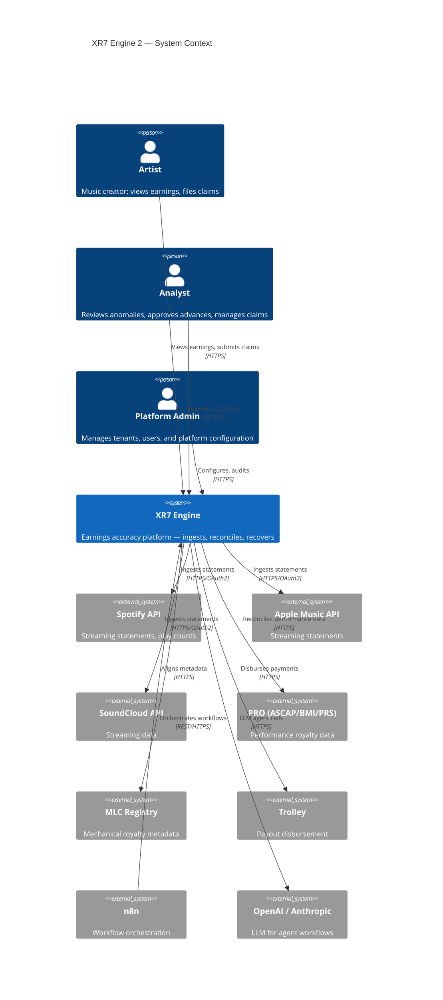
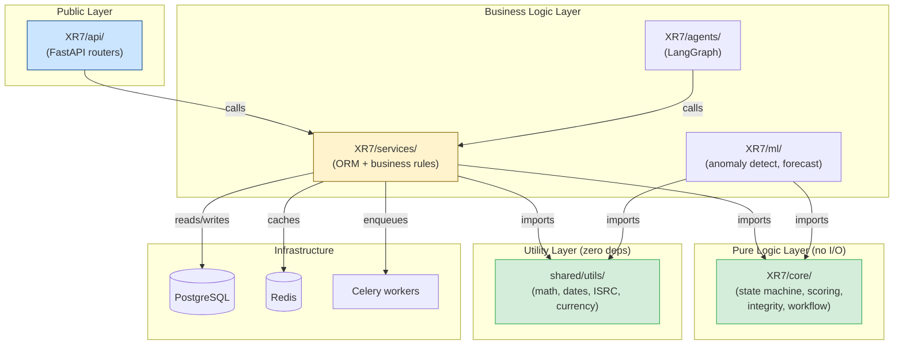
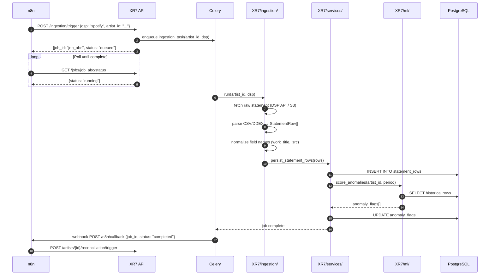
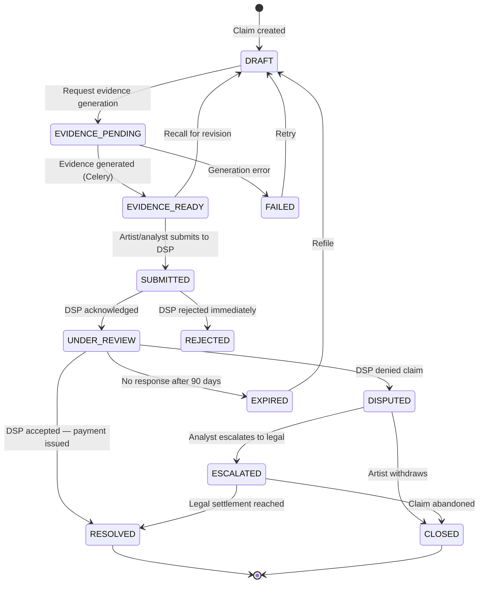
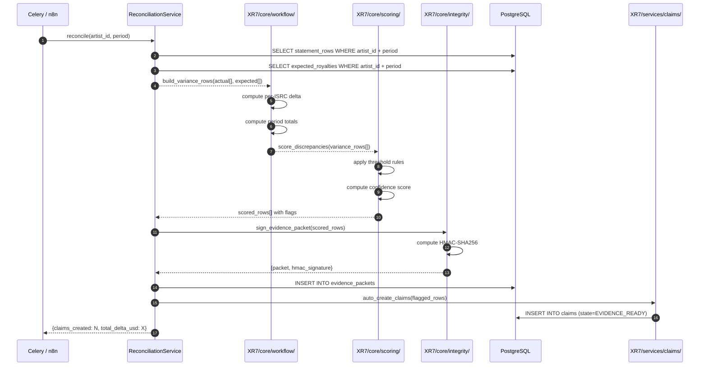
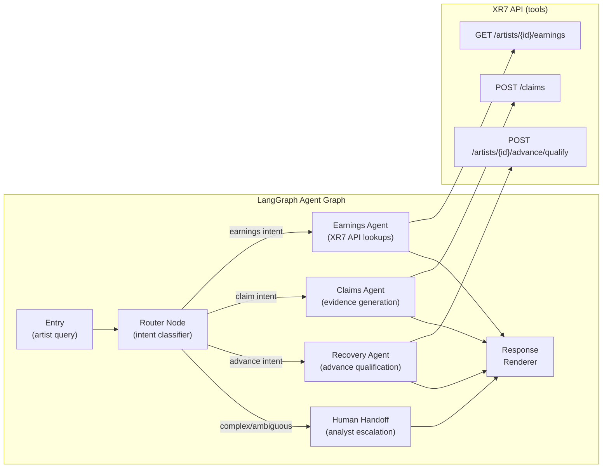
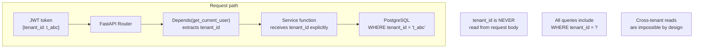
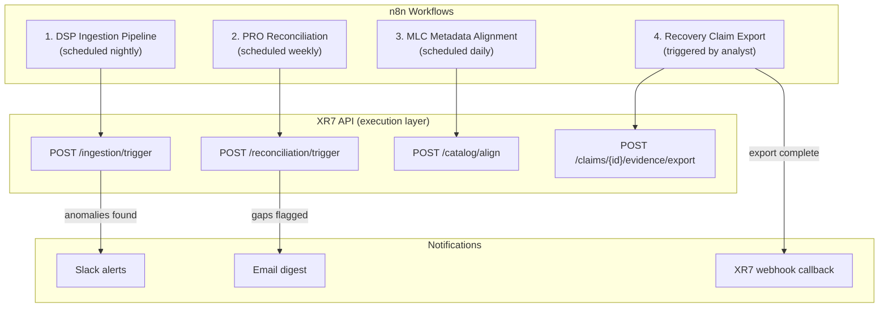
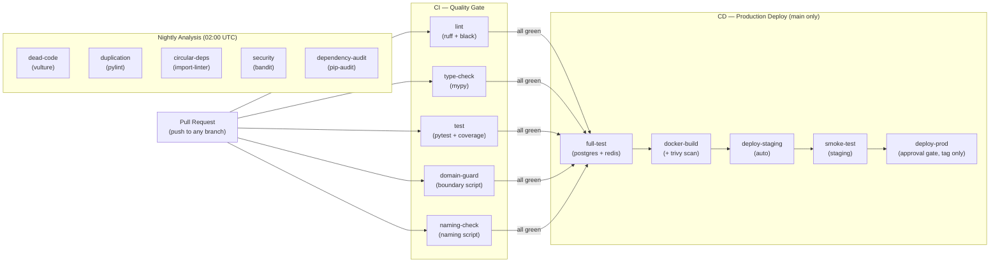

# XR7 Architecture Diagrams

All diagrams use [Mermaid](https://mermaid.js.org/) syntax. Render in GitHub, Obsidian, or any Mermaid-compatible viewer.

---

## Diagram 1: System Overview (C4 Context)

---

## Diagram 2: Module Layer Boundaries

---

## Diagram 3: DSP Ingestion Data Flow

---

## Diagram 4: Claims State Machine

---

## Diagram 5: Reconciliation Sequence (Earnings Accuracy Engine)

---

## Diagram 6: LangGraph Agent Orchestration

---

## Diagram 7: Multi-Tenancy Isolation Model

---

## Diagram 8: n8n Workflow Orchestration Overview

---

## Diagram 9: CI/CD Pipeline

